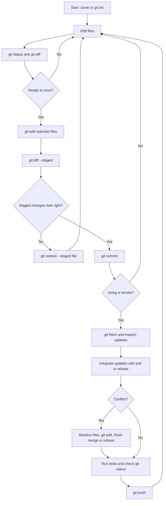

# Linux_Basics_Amrita
Linux Basics hands-on assignment covering file management, permissions, grep, zip, wget, and environment variables.

## Git Command Guide

This guide covers the Git commands used most often for personal projects and team collaboration. Git also has low-level plumbing commands; this is a practical command reference rather than a list of every internal command.

### 1. Install and configure Git

```bash
git --version
git config --global user.name "Your Name"
git config --global user.email "you@example.com"
git config --global init.defaultBranch main
git config --list
git config --show-origin --get user.name
```

- `git --version` checks whether Git is installed and shows its version.
- `git gitt --global` sets a preference for your user account. Omit `--global` to set it only for the current repository.
- `git config --list` displays effective configuration. Avoid sharing its output publicly if it contains private information.
- `git help <command>` or `git <command> --help` opens help for a command, for example `git help commit`.

### 2. Create or get a repository

```bash
git init
git clone <repository-url>
```

- `git init` starts tracking the current directory as a new Git repository.
- `git clone` copies an existing repository, including its history, to your computer.
- `git status` shows the current branch and whether files are modified, staged, or untracked.

### 3. Make and inspect changes

```bash
git status
git add <file>
git add .
git mv <old-name> <new-name>
git rm <file>
git diff
git diff --staged
git commit -m "Describe the change"
git show
git log
git log --oneline --graph --decorate --all
```

- `git add <file>` stages a particular file for the next commit; `git add .` stages changes under the current directory. Review before staging everything.
- `git mv` renames or moves a tracked file and stages the change. `git rm` removes a tracked file and stages the removal.
- `git diff` shows unstaged changes; `git diff --staged` shows what is staged for commit.
- `git commit -m "..."` saves the staged snapshot in local history. A commit does not automatically upload anything.
- `git show` displays a commit and its changes. `git show <commit>` inspects a specific commit.
- `git log` shows commit history. The `--oneline --graph --decorate --all` options make branch history compact and visual.
- `git diff <branch>...<branch>` can compare the changes introduced on one branch against another.

### 4. Branches and merging

```bash
git branch
git branch -a
git branch -m new-name
git switch -c feature-name
git switch main
git merge feature-name
git branch -d feature-name
```

- `git branch` lists local branches; `git branch <name>` creates a branch without switching to it.
- `git branch -a` lists local and remote-tracking branches. `git branch -m <new-name>` renames the current branch.
- `git switch -c <name>` git and switches to a branch. `git switch <name>` switches to an existing branch.
- `git merge <branch>` brings the named branch's changes into the branch you are currently on.
- `git branch -d <name>` deletes a branch that Git considers merged. Use `-D` only when you intentionally want to force-delete it.
- Older tutorials may use `git checkout` to switch branches or restore files. Prefer `git switch` for branches and `git restore` for files because their purposes are clearer.

### 5. Work with a remote repository

```bash
git remote -v
git remote add origin <repository-url>
git remote set-url origin <new-repository-url>
git remote remove origin
git fetch origin
git pull
git push -u origin main
git push
```

- A remote is another copy of the repository, commonly hosted on GitHub, GitLab, or a company server.
- `git remote -v` lists configured remote names and URLs. `git remote add` connects the local repository to a remote.
- `git remote set-url` changes a remote's URL; `git remote remove` disconnects that remote from the local repository.
- `git fetch` downloads remote commits and references without merging them into your current branch.
- `git pull` fetches and integrates remote changes into the current branch. Resolve conflicts if Git reports any.
- `git push` uploads local commits. `-u origin main` sets the upstream the first time, so later `git push` and `git pull` know which remote branch to use.
- `git push origin <branch>` pushes a particular branch. Check the branch name with `git branch` first.

### 6. Undo or recover changes

Choose an undo command based on whether the change is unstaged, staged, or already committed.

```bash
git restore <file>
git restore --staged <file>
git revert <commit>
git commit --amend
git reflog
```

- `git restore <file>` discards unstaged edits to that file. Those edits may be difficult to recover, so inspect with `git diff` first.
- `git restore --staged <file>` unstages a file but keeps its edits in your working directory.
- `git revert <commit>` makes a new commit that reverses an earlier commit. It is usually the safer choice for changes already shared with others.
- `git commit --amend` replaces the latest commit. Use it for a local commit that has not been shared; amending a shared commit can disrupt collaborators.
- `git reflog` lists recent movements of local references and can help find commits that no longer appear in normal history.

Reset modes differ in how much they change:

```bash
git reset --soft <commit>   # move HEAD; keep changes staged
git reset --mixed <commit>  # move HEAD; keep changes unstaged (default)
git reset --hard <commit>   # move HEAD and discard tracked working changes
```

`git reset --hard` can permanently discard work. Do not use it unless you are certain you want to lose those changes. Avoid rewriting published history; use `git revert` instead.

### 7. Stash temporary work

```bash
git stash push -m "short description"
git stash list
git stash show -p stash@{0}
git stash apply stash@{0}
git stash pop
git stash drop stash@{0}
```

- `git stash push` shelves tracked changes so you can switch tasks; add `-u` to include untracked files.
- `git stash list` lists saved stashes; `git stash show -p` displays one stash's patch.
- `git stash apply` restores a stash and keeps it in the list. `git stash pop` restores it and removes it if successful.
- `git stash drop` deletes a stash. Confirm you no longer need it first.

### 8. Resolve merge conflicts

When a merge or pull stops because of conflicts:

1. Run `git status` to see which files need attention.
2. Open each conflicted file and decide which content should remain. Remove the `<<<<<<<`, `=======`, and `>>>>>>>` marker lines.
3. Stage each resolved file with `git add <file>`.
4. Finish the operation with `git commit` for a merge, or follow Git's instructions for the operation you started.
5. Run `git status` and tests to confirm the repository is in a good state.

To cancel a merge that is still in progress, use `git merge --abort`. Do not use this after the merge has already completed.

### 9. Useful collaboration and inspection commands

```bash
git fetch --prune
git rebase main
git cherry-pick <commit>
git blame <file>
git grep "search text"
git bisect start
git worktree add ../project-feature feature-name
git tag
git tag -a v1.0.0 -m "Version 1.0.0"
git push origin v1.0.0
```

- `git fetch --prune` updates remote-tracking branches and removes references to remote branches that no longer exist.
- `git rebase main` replays your current branch's commits on top of `main`. Avoid rebasing commits that others already use unless your team agrees.
- `git cherry-pick <commit>` applies one commit to the current branch.
- `git blame <file>` shows which commit last changed each line; it is for tracing history, not assigning fault.
- `git grep` searches tracked files in the repository.
- `git bisect` helps find which commit introduced a bug by repeatedly testing commits between a known-good and known-bad point; finish with `git bisect reset`.
- `git worktree add` checks out another branch in a separate directory, so you can work on two branches at once. Remove an extra worktree with `git worktree remove <path>` after checking for uncommitted work.
- `git tag` lists tags. `git tag -a` creates an annotated release marker; push it separately to share it.
- `git clean -n` previews untracked files that `git clean -f` would delete. Do not run `git clean -fd` without carefully checking the preview.

For repositories that use submodules, `git submodule update --init --recursive` initializes and checks out their pinned contents after cloning.

### 10. Ignore generated or private files

Add patterns to a `.gitignore` file, for example:

```gitignore
.DS_Store
.env
build/
*.log
```

Then check the result with `git status`. `.gitignore` prevents matching untracked files from being added; it does not stop tracking a file that was already committed. Never commit passwords, tokens, or private keys.

### Git workflow chart



### Hands-on practice

Run these commands in a new practice directory. The exercise creates a local repository and does not upload anything.

```bash
mkdir git-practice-lab
cd git-practice-lab
git init
git config user.name "Your Name"
git config user.email "you@example.com"
printf "# My practice project\n" > README.md
git status
git add README.md
git diff --staged
git commit -m "Add project README"
git log --oneline
```

Create a feature branch, make a change, and merge it:

```bash
git switch -c add-notes
printf "\nPracticing Git branches.\n" >> README.md
git diff
git add README.md
git commit -m "Add practice notes"
git switch main
git merge add-notes
git log --oneline --graph
git status
```

Practice undoing safely: edit `README.md`, inspect with `git diff`, then run `git restore README.md` to discard that uncommitted edit. Next, make and stage another edit, then run `git restore --staged README.md` to unstage it while keeping the edit. Confirm both results with `git status`.

If your initial branch is not named `main`, use the name shown by `git branch` in the `git switch main` command. To practice remotes, create an empty repository on your hosting service, add its URL with `git remote add origin <repository-url>`, then push with `git push -u origin main`.
